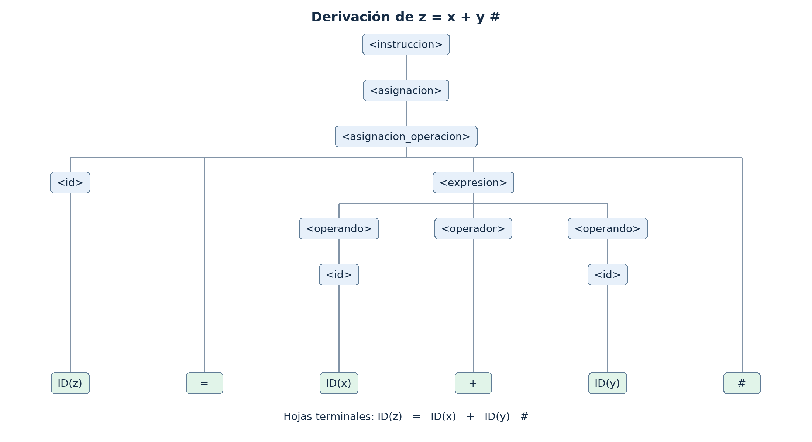

# LAB-3-TC

Laboratorio 3 - Diseño y Validación de Gramáticas Libres de Contexto.

**Asignatura:** Teoría de la Computación - INFO1148.  
**Carrera:** Ingeniería Civil en Informática.  
**Docente:** Marcos Lévano.  
**Tema:** Gramáticas Libres de Contexto (GLC).  
**Integrantes:** Jose Jimenez Saavedra; Demian Quezada Pasten.

El objetivo es diseñar, explicar y validar una gramática para un lenguaje de programación simplificado. El trabajo incluye identificación formal, producciones, derivaciones por la izquierda, árbol de derivación, validación de las cadenas solicitadas y una extensión de declaración de variables.

## Informe principal

- [Informe completo en Markdown](Informe_Laboratorio_3.md)
- [Informe para entregar en PDF](Lab_03_JefeGrupo_Jose_Jimenez.pdf)
- [Gramática base y extensión](gramatica.txt)
- [Resultados de las comprobaciones](evidencias/validacion.txt)
- [Revisión con la rúbrica](evidencias/revision_rubrica.md)

## Estructura

```text
LAB-3-TC/
├── README.md
├── Informe_Laboratorio_3.md
├── Lab_03_JefeGrupo_Jose_Jimenez.pdf
├── gramatica.txt
├── arbol_derivacion.mmd
├── documentos/        # enunciado, formato, rúbrica y guía de ejecución
├── evidencias/        # programa, árbol, resultados y revisión
└── validacion/        # gramática estructurada, derivaciones y verificador
```

## Visualizar el árbol



La imagen PNG y el [SVG vectorial](evidencias/arbol_derivacion.svg) pueden abrirse directamente. El archivo [arbol_derivacion.mmd](arbol_derivacion.mmd) se puede visualizar en un editor compatible con Mermaid o copiar en un bloque de código `mermaid` de Markdown. El diagrama conserva el orden de los hijos de cada producción. Sus hojas ID(z), ID(x) e ID(y) anotan lexemas del mismo terminal ID. El PNG y SVG se dibujan a partir del árbol comprobado; no se presentan como capturas de un motor Mermaid.

## Reproducir la validación

Se requiere Python 3.10 o posterior y únicamente su biblioteca estándar:

```text
python validacion/verificar.py
```

El proceso termina con código 0 si todas las comprobaciones pasan y actualiza `evidencias/validacion.txt`. Lee la misma gramática JSON que se transcribe en el informe, aplica reconocimiento general de GLC y comprueba derivaciones, nodos del árbol, programa completo y casos negativos. La validación sintáctica no ejecuta el programa.

La gramática trabaja sobre clases de tokens ID y NUM. Las reglas léxicas generales se explican en el informe y en `gramatica.txt`; las reservadas tienen prioridad. El inicio global es `<programa>`; las cadenas aisladas se comprueban como instrucciones. Se adopta una operación binaria por asignación y se ignoran los comentarios de bloque del ejemplo original. La extensión C añade declaraciones `entero id #` y `real id #`.

## Fuentes y entrega

Los tres documentos obligatorios se encuentran en [documentos/](documentos/): `Laboratorio_3.pdf`, `Formato_Informe_LAB_3.pdf` y `Rubrica_Laboratorio_3.pdf`. La guía `LAB-3-TC_Codex_Instrucciones.md` se conserva para trazabilidad. Ante discrepancias se priorizaron enunciado, plantilla y rúbrica; por ello se incluye PDF y la sección 5 de la plantilla. Las barras visuales del caso 8 se interpretan como saltos de línea. El caso 5 se comprueba en ambas variantes de las fuentes.

Este trabajo corresponde al Laboratorio 3 de Teoría de la Computación. No se utilizó JFLAP. La cobertura de los criterios no constituye una calificación garantizada.
